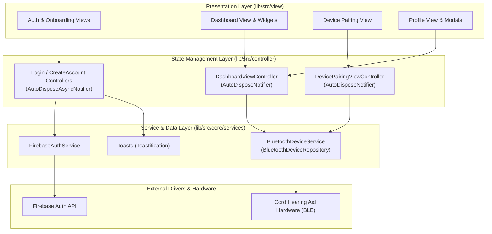
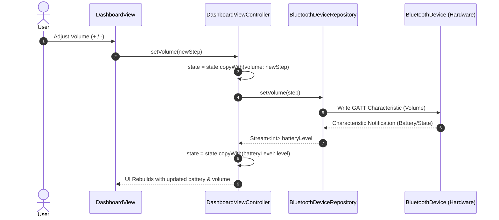
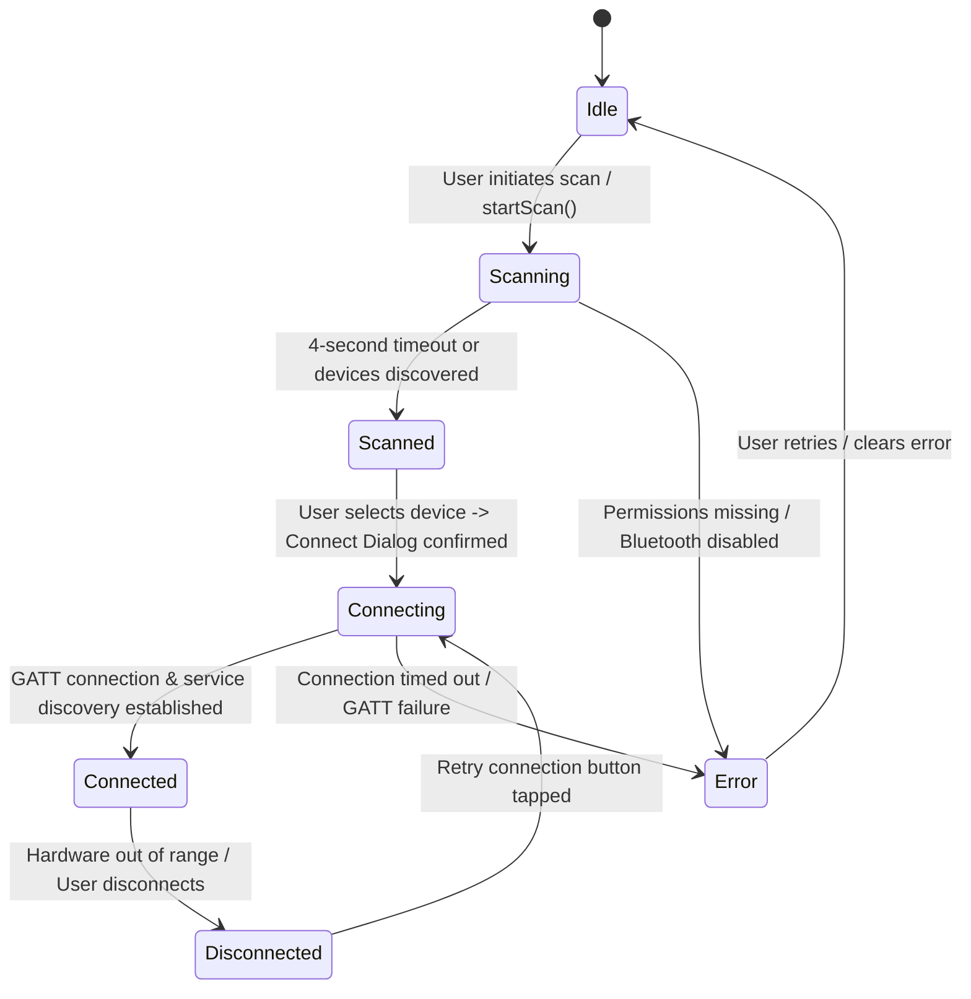

# Cord Hearing (Mobile Application)

[](https://flutter.dev)
[](https://dart.dev)
[](https://riverpod.dev)
[](https://firebase.google.com)
[](https://pub.dev/packages/flutter_blue_plus)
[](https://pub.dev/packages/very_good_analysis)

A cross-platform Flutter application built to manage, configure, and monitor **Cord Hearing Aid** hardware devices via Bluetooth Low Energy (BLE), paired with cloud authentication and profile persistence via Firebase.

---

## Table of Contents

- [Overview](#overview)
- [Key Features](#key-features)
- [System Architecture](#system-architecture)
  - [High-Level Architecture](#high-level-architecture)
  - [State & Data Flow](#state--data-flow)
  - [BLE Connection Lifecycle](#ble-connection-lifecycle)
- [Project Directory Structure](#project-directory-structure)
- [Core Modules & Implementation Details](#core-modules--implementation-details)
  - [1. Authentication & Onboarding](#1-authentication--onboarding)
  - [2. Bluetooth Device Service & BLE Lifecycle](#2-bluetooth-device-service--ble-lifecycle)
  - [3. Dashboard & Device Telemetry](#3-dashboard--device-telemetry)
  - [4. Profile & Hardware History](#4-profile--hardware-history)
  - [5. UI Components & Design System](#5-ui-components--design-system)
- [Platform-Specific Configurations](#platform-specific-configurations)
  - [Android Setup](#android-setup)
  - [iOS Setup](#ios-setup)
- [Getting Started](#getting-started)
  - [Prerequisites](#prerequisites)
  - [Installation & Setup](#installation--setup)
  - [Running the App](#running-the-app)
- [Testing & Code Quality](#testing--code-quality)
- [Troubleshooting & Common Issues](#troubleshooting--common-issues)
- [Roadmap & Hardware GATT Integration](#roadmap--hardware-gatt-integration)
- [License](#license)

---

## Overview

The **Cord Hearing** mobile client serves as the companion interface for Cord Hearing Aid wearers. It delivers:
- Fast BLE scanning, pairing verification, and signal recovery.
- Real-time device telemetry including battery status and connection health.
- Fine-grained hearing aid controls: 10-step digital volume adjustment and dual microphone beamforming modes (Omnidirectional and Directional).
- Secure user account creation and session persistence backed by Firebase Authentication.
- Mobile-first, responsive interface scaled across various phone displays using `flutter_screenutil`.

---

## Key Features

- **Intuitive Onboarding & Auth**: Interactive carousel onboarding, email/password signup and sign-in, with instant validation and status toasts via `toastification`.
- **Bluetooth Low Energy (BLE) Engine**:
  - Permission negotiation for Android 12+ (`BLUETOOTH_SCAN`, `BLUETOOTH_CONNECT`) and iOS CoreBluetooth.
  - Scan filtering for nearby hearing devices.
  - Safe connection negotiation designed to prevent Android GATT error 133.
- **Hardware Telemetry & Control**:
  - Live battery level monitoring with dynamic icon states (low, idle, charging).
  - Connection status badge with automatic disconnected alert sheet.
  - Stepped volume management (0–10) with multi-bar visualization.
  - Microphone mode toggle: Omnidirectional (ambient listening) vs Unidirectional/Directional (speech focus).
- **Profile & Device Management**:
  - Active user display with gravatar/profile placeholder and associated hardware ID.
  - Historical list of previously paired devices.
  - Safe disconnection flow with user confirmation modal.

---

## System Architecture

The application adopts a feature-driven layered architecture built on **Clean Architecture** principles and powered by **Riverpod 2.x**.

### High-Level Architecture



### State & Data Flow



### BLE Connection Lifecycle



---

## Project Directory Structure

```
cord_hearing/
├── android/                    # Android native configuration and Gradle files
├── assets/                     # Vector graphics (SVG), raster images (PNG), and logos
├── ios/                        # iOS Xcode project and CocoaPods configuration
├── lib/
│   ├── main.dart               # App entrypoint: initializes Firebase, orientations & ProviderScope
│   ├── app.dart                # CordHearing root widget: ScreenUtilInit & ToastificationWrapper
│   ├── firebase_options.dart   # Generated Firebase credentials per target platform
│   └── src/
│       ├── controller/         # Riverpod Notifiers (Business Logic & State)
│       │   ├── create_account_view_controller.dart
│       │   ├── dashboard_view_controller.dart
│       │   ├── device_pairing_view_controller.dart
│       │   └── login_view_controller.dart
│       ├── core/               # Shared constants, design tokens, primitives, & services
│       │   ├── app_assets.dart           # Static asset paths
│       │   ├── app_colors.dart           # Color palette constants
│       │   ├── services/
│       │   │   ├── bluetooth_device_service.dart # BLE abstraction & implementation
│       │   │   ├── firebase_auth_service.dart    # Firebase authentication wrapper
│       │   │   └── toast_service.dart            # Custom toast notifications
│       │   └── widgets/
│       │       ├── app_button.dart               # Adaptive filled & outlined button
│       │       ├── app_loading.dart              # Standardized loading indicator
│       │       ├── app_textfield.dart            # Custom form field with validation
│       │       ├── dialog_sheet.dart             # Adaptive dialogs and bottom sheets
│       │       └── onboarding_image_collage.dart # Onboarding photo mosaic
│       ├── model/              # Domain models (extensible for device telemetry)
│       └── view/               # User interface screens & local widgets
│           ├── authentication/
│           │   ├── create_account_view.dart      # Registration screen
│           │   ├── login_view.dart               # Sign-in screen
│           │   ├── onboarding_view.dart          # Multi-step feature slider
│           │   └── splash_view.dart              # Auth gate / splash redirect
│           ├── dashboard/
│           │   ├── dashboard_view.dart           # Primary telemetry & control dashboard
│           │   ├── device_pairing_view.dart      # BLE scan and connect screen
│           │   └── widgets/
│           │       ├── dashboard_header.dart     # Greeting and profile navigation
│           │       ├── device_status_card.dart   # Battery & connection indicators
│           │       ├── disconnected_bottom_sheet.dart # Disconnect alert modal
│           │       ├── microphone_mode_card.dart # Omni / Directional switch
│           │       └── volume_level_card.dart    # 10-level stepped volume control
│           └── profile/
│               ├── profile_view.dart             # Profile screen & disconnect button
│               └── widgets/
│                   ├── disconnect_bottom_sheet.dart # Disconnect confirmation modal
│                   ├── previously_paired_list.dart  # Paired history list
│                   └── profile_info_card.dart       # Account info summary card
├── test/                       # Unit and widget test suite
├── analysis_options.yaml       # Very Good Analysis lint rules
└── pubspec.yaml                # Project metadata and package dependencies
```

---

## Core Modules & Implementation Details

### 1. Authentication & Onboarding
- **`SplashView` (`lib/src/view/authentication/splash_view.dart`)**:
  Listens for the initial authentication state via `FirebaseAuth.instance.currentUser`. If an active session is found, navigates directly to `DevicePairingView`; otherwise routes to `OnboardingView`.
- **`OnboardingView` (`lib/src/view/authentication/onboarding_view.dart`)**:
  Two-page swipeable introduction detailing product benefits (simple controls, personalized sound), leading into either account creation or sign in.
- **`LoginViewController` & `CreateAccountViewController`**:
  Built on `AutoDisposeAsyncNotifier<void>`, delegating authentication calls to `FirebaseAuthService`. Any `FirebaseAuthException` messages are surfaced cleanly to users via `Toasts.showError()`.

### 2. Bluetooth Device Service & BLE Lifecycle
Located in `lib/src/core/services/bluetooth_device_service.dart`:
- **Repository Pattern**:
  `BluetoothDeviceRepository` defines an abstract contract with streams for `batteryLevel` and `connectionState`, plus methods for `checkAndRequestPermissions()`, `connect()`, `disconnect()`, `setVolume()`, and `setMicMode()`.
- **Dependency Injection**:
  `deviceRepositoryProvider` provides `BluetoothDeviceService`. This facilitates easy substitution with a mock repository for widget testing and UI design verification without physical hardware.
- **GATT Error 133 Mitigation**:
  Android BLE stacks frequently trigger GATT 133 when connecting while scanning or connecting without resetting prior state. The service implements:
  ```dart
  if (FlutterBluePlus.isScanningNow) {
    await FlutterBluePlus.stopScan();
  }
  await device.disconnect();
  await Future<void>.delayed(const Duration(seconds: 1));
  await device.connect(autoConnect: true, mtu: null);
  ```

### 3. Dashboard & Device Telemetry
Located in `lib/src/controller/dashboard_view_controller.dart` and `lib/src/view/dashboard/`:
- **`DashboardState`**:
  Tracks `batteryLevel` (0–100%), `connectionState` (e.g., 'Connected', 'Disconnected'), `micMode` (`MicMode.omni` / `MicMode.directional`), `volume` (0–10), and `deviceName`.
- **Reactive Stream Subscriptions**:
  The controller listens to `repo.batteryLevel` and `repo.connectionState`, updating the immutable state and safely cleaning up subscriptions when disposed (`ref.onDispose`).
- **Connection Loss Recovery**:
  `DashboardView` watches `dashboardProvider`. When state switches to disconnected, it immediately surfaces `DisconnectedBottomSheet`, giving the user a single tap to retry or return to pairing.

### 4. Profile & Hardware History
Located in `lib/src/view/profile/`:
- Displays user profile information (email parsed username, gravatar).
- Displays active paired device name and identifier.
- Lists previously paired devices (`PreviouslyPairedList`).
- Offers a clear "Disconnect device" action with confirmation bottom sheet to avoid accidental disconnects during use.

### 5. UI Components & Design System
Located in `lib/src/core/widgets/`:
- **`AppButton`**: Supports primary filled, secondary, and outlined modes with integrated loading spinner (`AppLoading`) and customizable icon positioning (`iconAlignment`).
- **`AppTextField`**: Standard text input supporting passwords with visibility toggle, custom validation rules, hints, and prefix/suffix widgets.
- **`DialogSheet`**: Unified wrapper for adaptive dialogs (`showAdaptiveDialog`) and bottom sheets (`showModalBottomSheet`), applying standard design radiuses and animations.
- **Screen Adaptation**: Base design dimensions are defined as **383 x 852** (iPhone 14/15 standard). All paddings, icon sizes, and dimensions leverage `.r`, `.w`, `.h`, and `.spMin` extensions from `flutter_screenutil`.

---

## Platform-Specific Configurations

### Android Setup

The app targets modern Android SDKs while retaining backwards compatibility with Android 10/11.

In `android/app/src/main/AndroidManifest.xml`:
```xml
<!-- Legacy BLE and location permissions -->
<uses-permission android:name="android.permission.BLUETOOTH" />
<uses-permission android:name="android.permission.BLUETOOTH_ADMIN" />
<uses-permission android:name="android.permission.ACCESS_FINE_LOCATION" />

<!-- Android 12+ (API 31+) permissions -->
<uses-permission
    android:name="android.permission.BLUETOOTH_SCAN"
    android:usesPermissionFlags="neverForLocation" />
<uses-permission android:name="android.permission.BLUETOOTH_CONNECT" />

<!-- Declare BLE Hardware Requirement -->
<uses-feature android:name="android.hardware.bluetooth" />
<uses-feature android:name="android.hardware.bluetooth_le" android:required="true" />
```

> **Note**: For Android builds, ensure `minSdkVersion` is at least 21 (configured in `android/app/build.gradle`).

### iOS Setup

In `ios/Runner/Info.plist`:
```xml
<key>NSBluetoothAlwaysUsageDescription</key>
<string>This app needs Bluetooth to scan for and connect to your hearing devices.</string>
<key>NSBluetoothPeripheralUsageDescription</key>
<string>This app needs Bluetooth to scan for and connect to your hearing devices.</string>
```

---

## Getting Started

### Prerequisites

- [Flutter SDK](https://docs.flutter.dev/get-started/install) (`>= 3.10.8 < 4.0.0`)
- [Dart SDK](https://dart.dev/get-dart)
- Xcode (for iOS builds, macOS required)
- Android Studio / Android SDK (for Android builds)
- A physical Android or iOS device (Bluetooth scanning cannot run on standard iOS/Android simulators)

### Installation & Setup

1. **Clone the repository**:
   ```bash
   git clone <repository-url>
   cd cord_hearing
   ```

2. **Install Flutter dependencies**:
   ```bash
   flutter pub get
   ```

3. **Configure Firebase**:
   The project includes `firebase.json` and default `lib/firebase_options.dart`. If connecting to your own Firebase project:
   ```bash
   flutterfire configure
   ```

4. **Verify iOS Pods (macOS only)**:
   ```bash
   cd ios && pod install && cd ..
   ```

### Running the App

Connect a physical device via USB or wireless debugging and run:

```bash
# Debug mode
flutter run

# Run on a specific device
flutter run -d <device-id>

# Run in profile/release mode
flutter run --release
```

---

## Testing & Code Quality

### Static Analysis
The codebase adheres to the strict rules of [`package:very_good_analysis`](https://pub.dev/packages/very_good_analysis).

To run linter checks:
```bash
flutter analyze
```

To automatically apply fixable linter suggestions:
```bash
dart fix --apply
```

### Running Tests
Execute unit and widget tests:
```bash
flutter test
```

### Mocking BLE for Widget Tests
To test UI views without physical Bluetooth hardware, override `deviceRepositoryProvider` in your test harness:

```dart
class MockBluetoothDeviceRepository implements BluetoothDeviceRepository {
  @override
  Stream<int> get batteryLevel => Stream.value(85);

  @override
  Stream<BluetoothConnectionState> get connectionState =>
      Stream.value(BluetoothConnectionState.connected);

  @override
  BluetoothDevice? get connectedDevice => null;

  @override
  Future<bool> checkAndRequestPermissions() async => true;
  @override
  Future<void> connect(BluetoothDevice device) async {}
  @override
  Future<void> disconnect() async {}
  @override
  Future<void> setVolume(int step) async {}
  @override
  Future<void> setMicMode(MicMode mode) async {}
  @override
  Future<void> requestStatus() async {}
}

// In test widget tree:
ProviderScope(
  overrides: [
    deviceRepositoryProvider.overrideWithValue(MockBluetoothDeviceRepository()),
  ],
  child: const CordHearing(),
);
```

---

## Troubleshooting & Common Issues

| Issue | Cause | Solution |
| :--- | :--- | :--- |
| **GATT Error 133 on Android** | Connecting immediately after scanning or connecting to an uncleared peripheral session. | Handled automatically in `BluetoothDeviceService.connect()` via scan cancellation and a 1-second reconnect cooldown. Ensure Bluetooth is toggled ON. |
| **No devices discovered during scan** | Location or Bluetooth permissions denied on Android; device not in pairing mode. | Grant "Nearby devices" and "Location" permissions in system settings. Ensure hearing aid is powered on and within 2 meters. |
| **Bluetooth fails on Simulator** | iOS Simulator and standard Android emulators lack physical BLE hardware. | Deploy to a physical testing device via `flutter run -d <physical-device>`. |
| **Firebase initialization failure** | Missing platform configuration files (`google-services.json` or `GoogleService-Info.plist`). | Ensure platform files exist or re-run `flutterfire configure`. |

---

## Roadmap & Hardware GATT Integration

The following GATT service integrations are planned in upcoming hardware firmware releases:

- [ ] **Standard Battery Service (UUID `0x180F`)**: Subscribing to characteristic `0x2A19` notification for real-time percentage stream.
- [ ] **Custom Cord Audio Service**:
  - Volume GATT Characteristic: Write-without-response step values (`0x00` - `0x0A`).
  - Mic Mode GATT Characteristic: Write modes (Omnidirectional `0x01`, Directional `0x02`).
  - Telemetry Characteristic: Charging state and hardware diagnostics.
- [ ] **Local Persistence**: Save paired hardware MAC / UUID using encrypted key-value storage for instant automatic reconnect on startup.

---

## License

This project is private and proprietary to **Cord Hearing**. Unauthorized copying, distribution, or modification is strictly prohibited.
